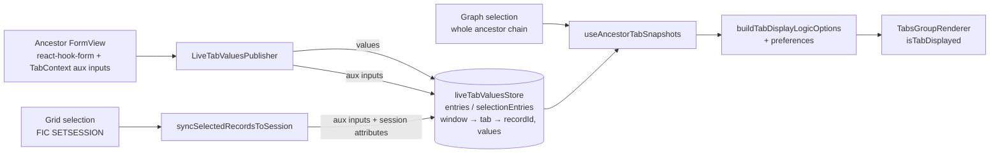

# Tab Display Logic

_Last updated: 2026-11-11 (ETP-5994; previously ETP-5614)_

## Overview

A child tab can define a display logic (`AD_Tab.DisplayLogic`, exposed as `tab.displayLogic` or
`tab.displayLogicExpression`). When it evaluates to false the tab is not rendered; when a hidden tab is
the parent of deeper tabs, those are hidden too.

Like Classic, the expression is evaluated against the whole context of the selected records:

- the selected record of the **parent and of every ancestor** (grandparent, etc.), with the unsaved
  values of their forms;
- the **auxiliary inputs and session attributes** the server computed for each of those selected
  records (also when the row is only selected in the grid);
- the user **session** and the user **preferences** loaded at login.

Examples (F&B International Group sample data):

| Tab | Display logic | Value comes from |
|-----|---------------|------------------|
| *Country and Region* › Country › **Region** | `@HasRegion@='Y'` | Parent record |
| *Sales Order* › Lines › **Related Products** | `@PRODUCTTYPE@='S'` | Auxiliary input of the selected line |
| *Product* › Product Categories › **Category Price Rule Version** | `@Ispricerulebased@='Y' & @Prod_Cat_Selection@='N'` | Grandparent record (product header) |
| *Purchase Order* › Lines › **Prereserved Qty** | `@StockReservations@!''` | `StockReservations` preference |

## Behavior

| Situation | Values the expression is evaluated against |
|-----------|--------------------------------------------|
| Parent shown as a grid, or form without edits | Persisted records of the parent and every ancestor (graph selection) |
| A form of any ancestor with unsaved edits | Persisted record overlaid with the form's current values |
| Discard / reload of a form | Persisted record again (the form is reset) |
| Row selected in a grid | Auxiliary inputs and session attributes returned by the `SETSESSION` call for that row |
| Form opened, or a callout changes an auxiliary input | Auxiliary inputs of the form's record |
| Name not defined by any of the above | User preference (window-scoped first, then global), as `OB.PropertyStore.get` |

- Selecting another row re-evaluates the child tabs with that row's context: values computed for a
  previous row are never used for the new one (they are kept per record id).
- Editing a header field referenced by the display logic of a child **or deeper** tab shows/hides it
  immediately, without saving.
- Cascade hide still applies: the parent tab's own display logic is evaluated against all the tabs
  above it, and if it is hidden all its children are hidden.
- When the active child tab becomes hidden, `Tabs` falls back to the first visible tab of the level.
- Tabs without display logic are unaffected.

## How it works

1. **Form values.** `LiveTabValuesPublisher` (inside the form's `FormProvider`) finds every tab below
   the form's tab (`getDescendantTabs`) and the fields their display logic reads
   (`getTabDisplayLogicDependencies`). It watches only those fields plus `id` and publishes
   `{ recordId, values }` to `liveTabValuesStore.entries`. Nothing is published while the form is
   initializing, and the entry is cleared when the form holds no saved record or unmounts.
2. **Auxiliary inputs of the form.** The same publisher publishes `TabContext.auxiliaryInputs` (filled by
   the form initialization and by callouts) to `liveTabValuesStore.selectionEntries` for the form's
   record. That entry is not cleared when the form closes.
3. **Auxiliary inputs of a grid selection.** Selecting rows already runs a FIC `SETSESSION` call
   (see [Session Sync API](../../api/session-sync-api.md)). Its response (`buildSessionAttributes`:
   auxiliary inputs + session attributes) is published to `selectionEntries` for the last selected
   record, at every tab level. Root tabs still merge it into the global session as before.
   Values published for the same record add up; values for another record replace them.
4. **Ancestor chain.** `useAncestorTabSnapshots(parentTab)` walks `graph.getParent` up to the root and
   returns, for each tab, its selected record overlaid with its live values (`overlayLiveValues`) and the
   `selectionEntries` values published **for that same record id**. It re-renders on `selected` /
   `unselected` graph events of any tab in the chain and on store changes of the window.
5. **Context.** `buildTabDisplayLogicOptions` turns the snapshots into the options of the existing
   evaluation engine (`getEvaluationContext`): the direct parent as `values`, the other ancestors merged
   from the root down as `parentValues` (the closest one wins), all auxiliary inputs merged the same way,
   the session, and `resolveUnprefixedPreferences: true`.
6. **Evaluation.** `isTabDisplayed` compiles and evaluates the expression (`compileExpression`,
   `toClassicBoolean`). Value normalization (`true` → `'Y'`, column ↔ property names) is unchanged; see
   [Display Logic Expression Parsing](../display-logic-expression-parsing.md).

## Decisions

- **Client-side only.** The client evaluates the raw `displayLogic` against a case/underscore-insensitive
  context mapped by column name, so giving it the right context is enough. The backend tab metadata and
  its `displayLogicExpression` are unchanged, and no request was added: the `SETSESSION` call that grid
  selection already made is reused.
- **Context kept per record id.** Auxiliary inputs used to reach child tabs only through the global
  session, merged after a form was opened and never tied to a record, so a child tab kept the visibility
  of a previously selected row. They are now stored per tab and record and only used for that record.
- **Form auxiliary inputs outlive the form.** Classic keeps them in the view form shared with the grid
  until another record is selected; the New UI keeps them in `selectionEntries` for the same reason.
- **Preferences only for tab display logic.** `resolveUnprefixedPreferences` is an opt-in option of
  `buildEvaluationContext`; field display logic, read-only logic and toolbar logic are unchanged.
  Classic adds `OB.PropertyStore.get(name, windowId)` for every bare name of a tab's display logic
  (`preferenceValues`); the New UI reads the preferences saved at login (`/meta/preferences`).
- **Window-level store instead of context.** Child tabs are rendered outside the ancestors' form
  providers and `TabContext` is per tab, so the small `liveTabValuesStore` is used (volatile, outside
  URL/state persistence, reset on logout).
- **Subscribe only to referenced fields.** Forms whose descendant tabs have no display logic render no
  watcher and never write to the store. Publishing identical values is a no-op.
- **Record id taken from the form itself.** The `id` is watched together with the values so both come
  from the same form state; values from a previous record or from a new record never apply.
- **Stable tab list.** `TabsGroupRenderer` keeps passing the same array to `Tabs` while the visible
  tabs do not change (`haveSameTabs`).

## Differences with Classic

- Classic merges each level's record, auxiliary inputs and session attributes before merging the
  parent level under it, so an auxiliary input of the parent could override a column of the same name in
  the grandparent. The New UI always gives record values priority over auxiliary inputs. Such a name
  clash is not expected (the FIC already skips auxiliary inputs named like a column of the tab).
- Classic evaluates once with the previous row's auxiliary inputs and again when `SETSESSION` returns.
  The New UI only uses values computed for the selected record, so until the response arrives a name
  that only an auxiliary input defines falls back to the session (as before) and then to `''`.
- Preferences saved after the window was opened are not re-read until the next evaluation.

## Tests

- Unit tests (Jest) cover the store, the publishers, the ancestor context and the preference option.
- Playwright smoke probes run on every PR: **GRDg** (an auxiliary input of the selected grid row: Sales Order ›
  Lines › Related Products) and **FRMf** (a grandparent value, unsaved: Product › Product Categories › Category
  Price Rule Version). See [Playwright E2E](../../testing/playwright-e2e/README.md).
- The preference case has no E2E probe: the sample data has no `StockReservations` preference, and creating one
  changes how every order is booked (`C_ORDER_POST` checks that any such preference exists), which would affect
  the specs running in parallel. It is covered by unit tests.

## Configuration

None. Any tab display logic defined in the Application Dictionary is supported.

## Main files

| File | Role |
|------|------|
| `packages/MainUI/components/window/TabsContainer.tsx` | Evaluates tab display logic per level (`TabsGroupRenderer`) |
| `packages/MainUI/hooks/useAncestorTabSnapshots.ts` | Selected record, live values and context of the parent and every ancestor |
| `packages/MainUI/utils/tabDisplayLogic/ancestorContext.ts` | `overlayLiveValues`, `toAncestorSnapshot`, `buildTabDisplayLogicOptions`, `isTabDisplayed` |
| `packages/MainUI/components/Form/FormView/LiveTabValuesPublisher.tsx` | Publishes the referenced form values and the form's auxiliary inputs |
| `packages/MainUI/utils/hooks/useTableSelection/sessionSync.ts` | Publishes the `SETSESSION` context of a grid selection |
| `packages/MainUI/stores/liveTabValuesStore.ts` | Live values (`entries`) and per-record context (`selectionEntries`) per window and tab |
| `packages/MainUI/utils/evaluation/buildEvaluationContext.ts` | `resolveUnprefixedPreferences` option |
| `packages/MainUI/hooks/useLiveTabRecord.ts` | Persisted record + live values for a single tab |
| `packages/MainUI/utils/expressions/mergeLiveValues.ts` | `mergeDefinedValues` |
| `packages/MainUI/utils/tabUtils.ts` | `getTabDisplayLogic`, `getChildTabs`, `getDescendantTabs`, `getTabDisplayLogicDependencies`, `haveSameTabs` |
